# Fuyao skyrocketing

English | [简体中文](README_ZH.md)

**Master’s in Computer Technology · Research & Engineering Specialist**

I work on acoustic monitoring, AI integration, and robotics applications, connecting devices, data, and software. Outside work, I build practical tools for macOS, Android, and the web.

[Website](https://fuyaoskyrocket.ing/)

<picture>
  <source media="(prefers-color-scheme: dark)" srcset="https://skillicons.dev/icons?i=swift,kotlin,ts,svelte,py,java,debian,docker&amp;theme=dark&amp;perline=8">
  
</picture>

## Approach

High cohesion, low coupling. Native interfaces, clear wording, and maintainable systems. AI-assisted development, backed by review and testing.

Beyond code: photography, music, strength training, and tinkering with Debian and macOS.

<!-- Generated by .github/workflows/snake.yml; available after its first successful run. -->
<picture>
  <source media="(prefers-color-scheme: dark)" srcset="https://raw.githubusercontent.com/skyrocketingHong/skyrocketingHong/profile-snake/snake-dark.svg">
  
</picture>
